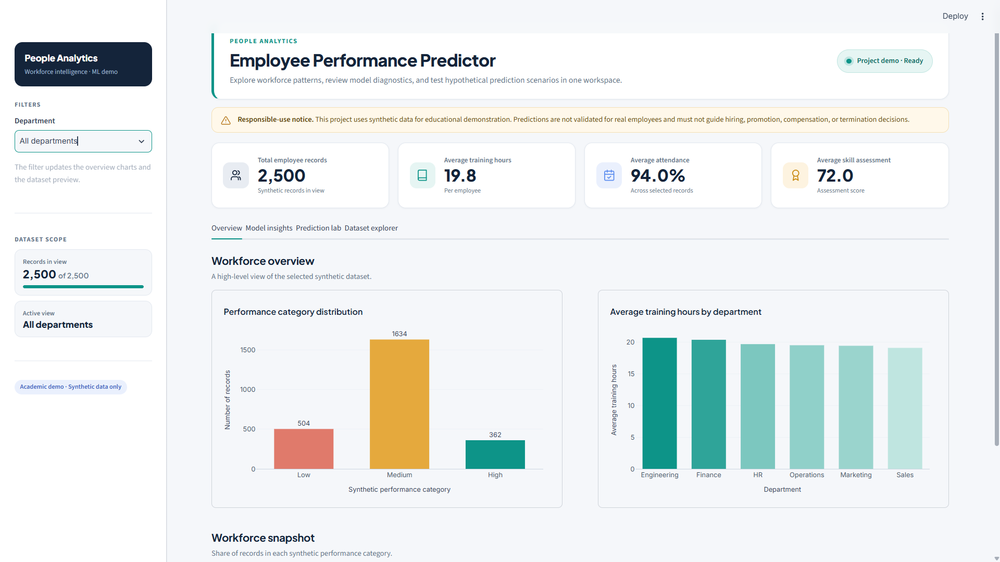
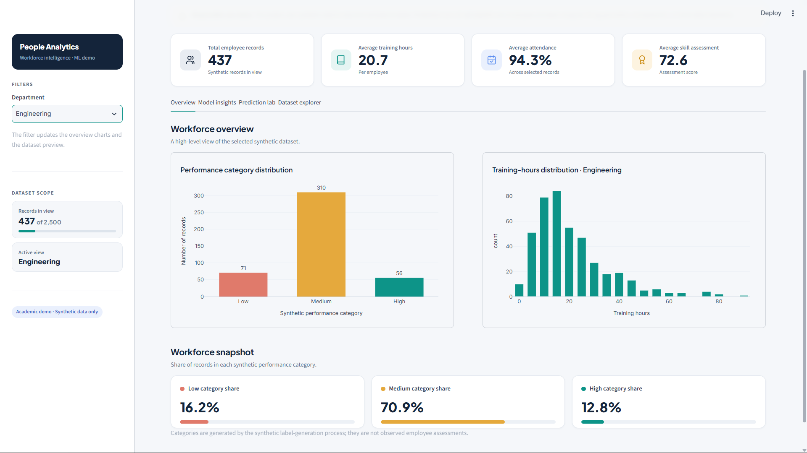
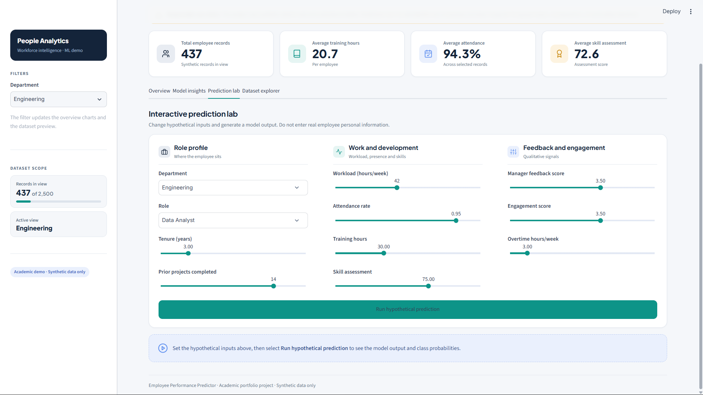
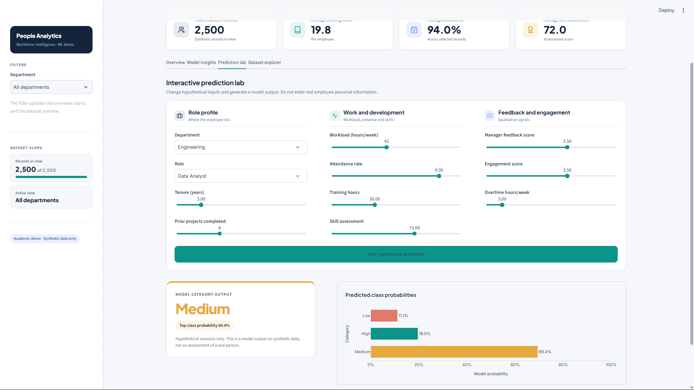
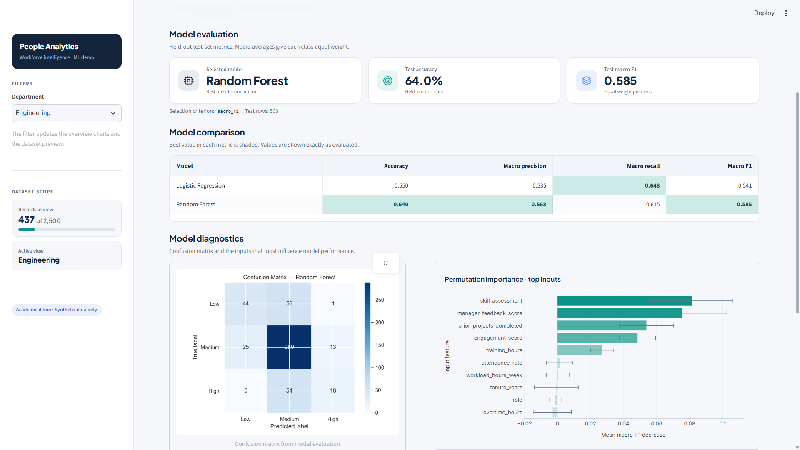
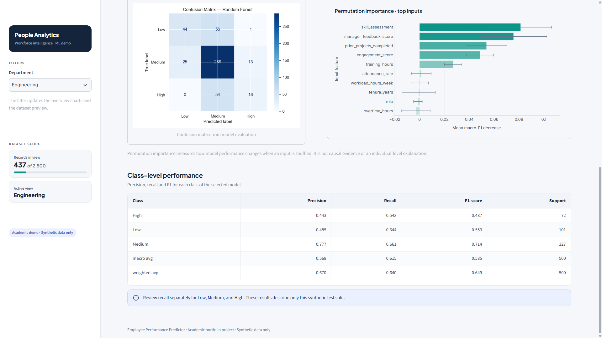
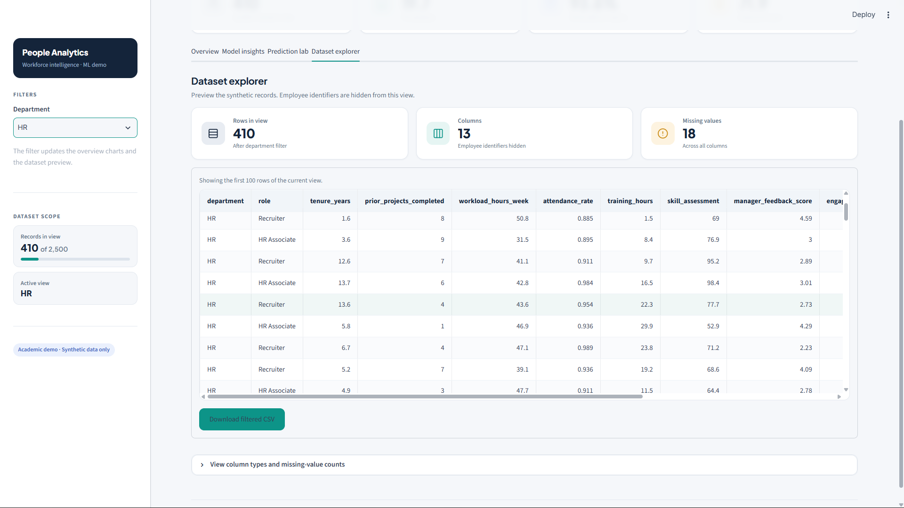
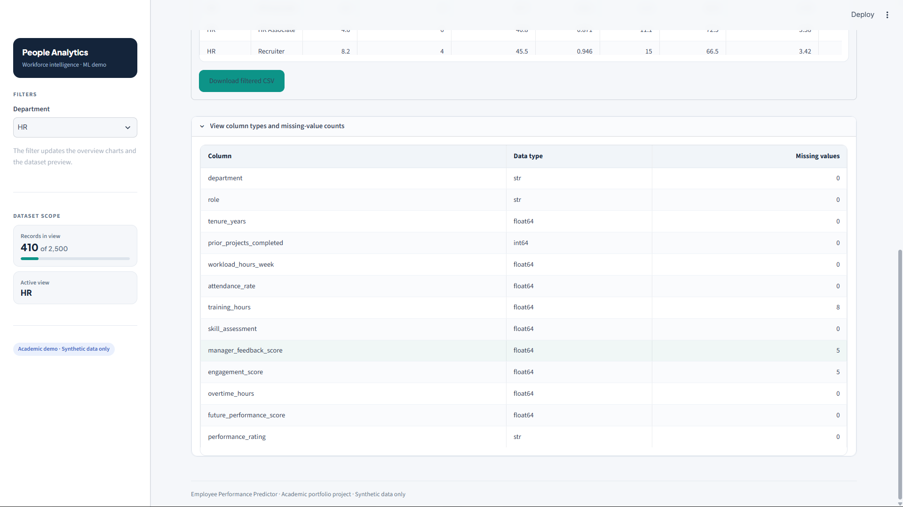
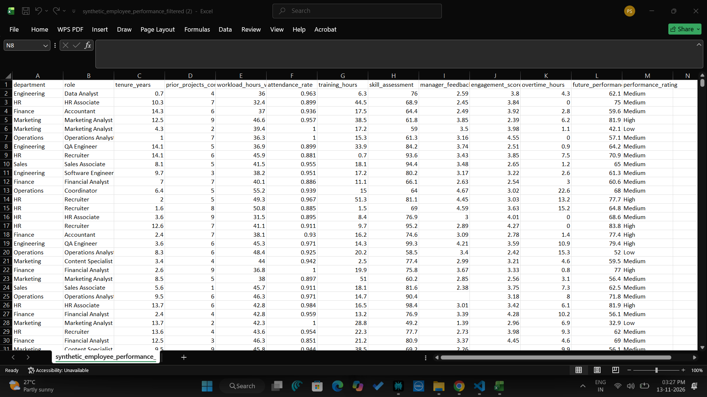
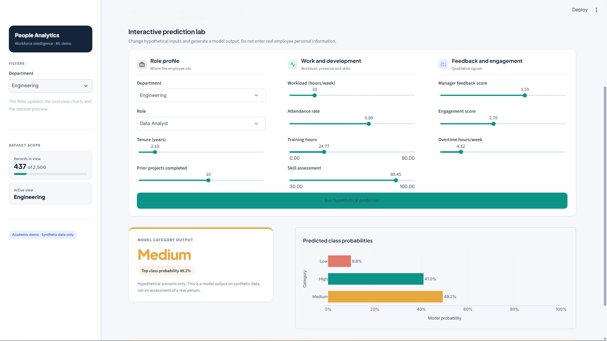

# Employee Performance Predictor using Data Analytics

An end-to-end educational Data Science project that demonstrates synthetic HR-style data generation, exploratory data analysis, feature preprocessing, multiclass classification, evaluation, and an interactive Streamlit dashboard.

> **Responsible-use notice:** This project uses entirely synthetic data. It is a learning and decision-support demonstration only. It must not be used to rank real employees or make hiring, promotion, compensation, termination, or other employment decisions.

## 1. Problem statement

Organizations may analyse workforce indicators to understand training needs, workload patterns, and development opportunities. This project demonstrates how a supervised ML workflow could explore relationships between prior-period work indicators and a simulated future performance category.

The model predicts one of three synthetic labels: `Low`, `Medium`, or `High`.

## 2. Business value demonstrated

- Summarise department-level workforce indicators.
- Explore relationships between training, workload, skills, engagement, and synthetic ratings.
- Compare interpretable and nonlinear classification baselines.
- Demonstrate a repeatable data-to-dashboard workflow.

The outputs are not recommendations about individual employees.

## 3. Tech stack

- Python, Pandas, NumPy
- Scikit-learn Pipelines, Logistic Regression, Random Forest
- Matplotlib, Seaborn, Plotly
- Streamlit
- Git and GitHub

## 4. Architecture

```text
Synthetic HR-style data generator
             |
             v
      CSV dataset
             |
             v
  Validation / preprocessing
  imputation + encoding + scaling
             |
             v
 Logistic Regression + Random Forest
             |
             v
 Hold-out evaluation (macro-F1, precision,
 recall, accuracy, confusion matrix)
             |
             v
 Saved model + metrics + charts
             |
             v
 Streamlit analytics dashboard
             |
             v
 Hypothetical prediction demonstration
```

## 5. Repository structure

```text
Employee-Performance-Predictor/
├── data/                 # Generated CSV (created by main.py)
├── docs/                 # Data dictionary and model card
├── images/               # Generated EDA and evaluation charts
├── models/               # Saved model pipeline (generated)
├── outputs/              # Metrics JSON (generated)
├── src/
│   ├── config.py
│   ├── data_generation.py
│   ├── eda.py
│   ├── model.py
│   └── predict.py
├── tests/
│   └── test_pipeline.py
├── app.py                # Streamlit dashboard
├── main.py               # End-to-end pipeline
├── requirements.txt
└── README.md
```

## 6. Setup

### Windows PowerShell

```powershell
cd Employee-Performance-Predictor
py -3.13 -m venv .venv
.\.venv\Scripts\Activate.ps1
python -m pip install --upgrade pip
pip install -r requirements.txt
```

If PowerShell blocks activation, run this for the current terminal only:

```powershell
Set-ExecutionPolicy -Scope Process -ExecutionPolicy Bypass
.\.venv\Scripts\Activate.ps1
```

### macOS / Linux

```bash
cd Employee-Performance-Predictor
python3 -m venv .venv
source .venv/bin/activate
python -m pip install --upgrade pip
pip install -r requirements.txt
```

## 7. Run the project

Generate data, EDA charts, train models, evaluate, and save the selected pipeline:

```bash
python main.py
```

Launch the dashboard:

```bash
streamlit run app.py
```

Generate a sample prediction from the terminal:

```bash
python -m src.predict
```

Run basic tests (optional; install pytest first with `pip install pytest`):

```bash
pytest -q
```

## 8. Dataset and target design

The generator creates 2,500 synthetic records by default. Inputs include department, role, tenure, prior projects, workload, attendance, training, skill assessment, manager feedback, engagement, and overtime.

The synthetic future score is used only to create the target category. The score itself and the employee identifier are excluded from model inputs to prevent direct target leakage. Missing values are introduced intentionally so the preprocessing pipeline can demonstrate imputation.

See [`docs/data_dictionary.md`](docs/data_dictionary.md).

## 9. Model development and evaluation

Two models are compared:
- Logistic Regression: baseline with a relatively interpretable linear decision boundary.
- Random Forest: nonlinear ensemble baseline.

The best pipeline also gets a model-agnostic permutation-importance diagnostic. It estimates the decrease in macro-F1 when an input column is shuffled; it is not causal and may be affected by correlated features. The preprocessing pipeline uses median imputation and scaling for numerical features, and most-frequent imputation plus one-hot encoding for categorical features. Transformations are fitted only on training data through an sklearn Pipeline.

The model is selected using macro-F1, alongside accuracy, macro precision, macro recall, class-level report, and a confusion matrix. Actual metrics are generated when you run the project; they are intentionally not hardcoded here.

Generated artifacts:
- `images/rating_distribution.png`
- `images/feature_correlation.png`
- `images/training_by_rating.png`
- `images/confusion_matrix.png`
- `images/permutation_importance.png`
- `outputs/permutation_importance.csv`
- `outputs/model_metrics.json`
- `models/performance_pipeline.joblib`

## 10. Dashboard

The interactive Streamlit dashboard provides four main modules:

### 1. Overview
- Key workforce analytics KPIs
- Performance rating distribution
- Department-wise training analysis
- Performance-related visualisations

### 2. Model Insights
- Logistic Regression and Random Forest comparison
- Accuracy and macro evaluation metrics
- Confusion matrix
- Permutation feature importance
- Class-wise classification report

### 3. Prediction Lab
Generate hypothetical performance predictions using 11 input features:

- Department
- Role
- Tenure
- Prior projects completed
- Workload hours per week
- Attendance rate
- Training hours
- Skill assessment
- Manager feedback score
- Engagement score
- Overtime hours

The output includes a predicted performance category (Low, Medium, or High) and corresponding class probabilities.

### 4. Dataset Explorer
- Explore synthetic employee records
- Filter records by department
- Inspect dataset columns and data types
- Review missing values
- Download filtered records

## 11. Responsible AI and limitations

This is not a validated HR assessment tool. Synthetic labels are produced by a known formula, which can make test results look stronger than performance on real organizational data. Excluding protected attributes does not guarantee fairness; proxies and measurement bias can remain.

Before any real-world research, an organization would need lawful data access, employee notice, data minimisation, security controls, validated job-related criteria, representative temporal and external validation, calibration, subgroup error analysis, independent review, and meaningful human oversight. No automated employment decisions should be made from this model.

See [`docs/model_card.md`](docs/model_card.md).

## 12 Project Screenshots

### 1. Dashboard Overview


### 2. Workforce Analytics


### 3. Prediction Lab


### 4. Prediction Results


### 5. Model Evaluation


### 6. Model Diagnostics


### 7. Dataset Explorer


### 8. Data Quality Analysis


### 9. Dataset Excel Preview


### 10. Alternative Prediction Scenario



## 13. Future improvements

- Evaluate on a genuinely public, documented dataset where licensing and intended use permit.
- Add temporal holdout evaluation when multiple periods are available.
- Add probability calibration and permutation importance / SHAP with careful interpretation.
- Add subgroup error analysis using appropriately governed audit data.
- Add SQLite/PostgreSQL for a simulated data layer.
- Add API serving and automated tests/CI.
- Extend the analytics to aggregate training needs or attrition research, with separate targets and safeguards.

## 14. Interview talking point

"I developed an end-to-end Employee Performance Prediction and Analytics system using Python and Machine Learning. The project involved synthetic HR data analysis, preprocessing using Scikit-learn pipelines, and comparison of Logistic Regression and Random Forest classifiers.

I evaluated the models using accuracy, precision, recall, macro F1-score, and confusion matrices. I selected Random Forest based on macro F1-score and integrated the saved ML pipeline into an interactive Streamlit dashboard.

The dashboard includes workforce analytics, model insights, a prediction lab, and a dataset explorer. I also addressed target leakage, model interpretability, and responsible AI considerations."

## 15. License and data

The code may be shared for educational use. The generated dataset is synthetic and can be recreated using `python main.py`. Do not upload real employee data or personal information.

